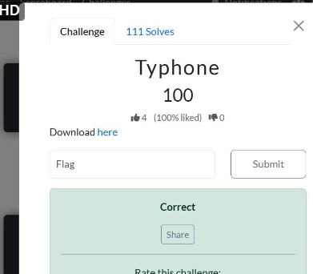

# CSCV2026 — Crypto — Typhone

**Thể loại:** Cryptography (Crypto)

**Kỹ thuật:** LCG recovery · Håstad broadcast · AES-GCM nonce reuse · LFSR · Pohlig–Hellman · SHA-256 length extension · ECDSA Hidden Number Problem · Boneh–Durfee · Coppersmith

**File đề bài:** `typhone.7z` → `challenge_typhon.py`, `output_typhon.txt`

**Tái hiện:** [`solve.py`](solve.py) chạy toàn bộ chuỗi khai thác; hướng dẫn ở [mục 12](#12-chạy-lại-lời-giải).

## Flag

```text
CSCV2026{typh0n_LCG_h4st4d_w13n3r_LFSR_PH_SHA_C2log_RAT_ECDSA_BD_Coppersm1th}
```

Flag được giải mã bằng `decrypt_and_verify()` ở lớp AES-GCM cuối, nên cả plaintext lẫn authentication tag đều đã được kiểm tra. Flag cũng đã được người chơi xác nhận đúng.



## 1. Tổng quan

Archive `typhone.7z` chứa:

- `challenge_typhon.py`: mã nguồn sinh challenge.
- `output_typhon.txt`: dữ liệu của instance cần giải, dưới dạng JSON.

Đây là một chuỗi bài toán mật mã. Kết quả của mỗi lớp cung cấp khóa hoặc dữ liệu để mở lớp tiếp theo. AES-GCM đóng vai trò bọc dữ liệu; các điểm yếu nằm ở cách sinh khóa, lộ thông tin và tái sử dụng nonce.

```text
LCG → Håstad broadcast → GCM nonce reuse → LFSR
    → Pohlig–Hellman → SHA-256 length extension
    → BEACON log → RAT config → ECDSA nonce nhỏ
    → Boneh–Durfee → Coppersmith → AES-GCM → flag
```

Điểm đáng chú ý: mã nguồn còn tạo một RSA có private exponent nhỏ trong payload `γ`, gợi ý Wiener. Tuy nhiên, đường giải này bỏ qua RSA đó vì known plaintext và nonce GCM bị dùng lại đã đủ để lấy đầu ra LFSR. Các trường `meta.sessions` và `meta.escrow` cũng không cần dùng.

Quy ước trong writeup:

```python
H16 = lambda b: hashlib.sha256(b).digest()[:16]
```

Mỗi đối tượng `Φ` có `N`, `C`, `T`, lần lượt là nonce, ciphertext và tag, được biểu diễn bằng hex. Để giải mã:

```python
def decrypt(key, obj):
    return AES.new(
        key, AES.MODE_GCM, nonce=bytes.fromhex(obj['N'])
    ).decrypt_and_verify(
        bytes.fromhex(obj['C']), bytes.fromhex(obj['T'])
    )
```

## 2. Lớp α: khôi phục LCG

Nguồn sinh số ngẫu nhiên có dạng:

```math
x_{i+1} = ax_i+c \pmod M,\qquad M=2^{127}-1.
```

Output công khai năm trạng thái liên tiếp. Gọi chúng là `x[0]` đến `x[4]`. Lấy hiệu hai phương trình liên tiếp:

```math
x_2-x_1 \equiv a(x_1-x_0)\pmod M.
```

Suy ra:

```math
a=(x_2-x_1)(x_1-x_0)^{-1}\pmod M,
\qquad c=x_1-ax_0\pmod M.
```

Trong instance này nghịch đảo tồn tại. Ta kiểm tra lại cả năm đầu ra, rồi dự đoán trạng thái kế tiếp:

```python
a = (xs[2] - xs[1]) * pow(xs[1] - xs[0], -1, M) % M
c = (xs[1] - a * xs[0]) % M
assert all((a*x+c) % M == y for x, y in zip(xs, xs[1:]))
next_state = (a * xs[-1] + c) % M
k0 = H16(next_state.to_bytes(16, 'big'))
```

`k0` mở payload `α`. Plaintext dài 96 byte, gồm sáu số nguyên 16 byte theo thứ tự:

```text
n0 || n1 || n2 || c0 || c1 || c2
```

## 3. Håstad broadcast: cùng plaintext, RSA e = 3

Ba ciphertext có dạng:

```math
c_i=s_1^3\bmod n_i.
```

`s1` là 15 byte, không có padding. Ba modulus trong instance nguyên tố cùng nhau từng đôi. CRT cho một số `C` thỏa mãn đồng thời ba đồng dư.

Do `s1` nhỏ hơn từng modulus:

```math
s_1^3<n_0n_1n_2.
```

Vì vậy nghiệm CRT chuẩn chính là số nguyên `s1³`, không chỉ là một giá trị đồng dư. Lấy căn bậc ba nguyên để khôi phục `s1`:

```python
C = int(crt(ns, cs)[0])
s1, exact = integer_nthroot(C, 3)
assert exact
Kw = H16(int(s1).to_bytes(15, 'big'))
```

Độ dài 15 byte phải được giữ nguyên, kể cả khi `s1` có byte 0 ở đầu. Dùng `Kw` giải mã `γ`.

## 4. Lớp γ: nonce reuse của GCM và khôi phục LFSR

Payload `γ` chứa hai ciphertext `c1`, `c2`, cùng nonce, cùng khóa `Gk`, và plaintext `p1` đã biết.

Phần mã hóa của GCM dùng CTR. Cùng khóa và nonce tạo cùng keystream `S`:

```math
C_1=P_1\oplus S,\qquad C_2=P_2\oplus S.
```

Do đó:

```math
P_2=C_1\oplus C_2\oplus P_1.
```

Mã nguồn tạo `P2 = lf + random_bytes(72)`, trong đó `lf` là 8 byte đầu tiên lấy từ LFSR. Chỉ cần XOR rồi lấy 8 byte đầu:

```python
lf = bytes(a ^ b ^ c for a, b, c in zip(C1, C2, P1))[:8]
```

Không cần khôi phục `Gk`, không cần giả mạo tag và không cần giải RSA `nw, ew, wc` trong payload.

LFSR có state 32 bit, mỗi bước xuất bit thấp nhất trước khi dịch phải:

```python
b = state & 1
fb = ((state >> 31) ^ (state >> 29) ^
      (state >> 25) ^ (state >> 23)) & 1
state = (state >> 1) | (fb << 31)
```

32 bit đầu ra đầu tiên chính là 32 bit của state ban đầu, theo thứ tự từ thấp lên cao. Hàm `lB()` đóng gói các bit đầu ra theo thứ tự MSB-first vào từng byte, nên cần tách bit đúng thứ tự:

```python
bits = [(v >> i) & 1 for v in lf for i in range(7, -1, -1)]
state = sum(bits[i] << i for i in range(32))
```

Chạy lại 64 bước và so sánh với toàn bộ `lf` để kiểm tra state. Sau đó lấy 128 bit tiếp theo thành `kL`, vì trong source:

```python
lf = lB(8)
kL = lB(16)
```

Kết quả:

```text
kL = 47944dfcec305dc85403a356998b25b5
```

## 5. Lớp δ: logarit rời rạc trên nhóm có cấp smooth

`kL` mở `δ`, cho `p`, `g = 2`, `h` với:

```math
h=g^x\pmod p,\qquad 0\le x<2^{128}.
```

Điểm yếu là `p−1` phân tích hoàn toàn thành các thừa số nhỏ. Trong instance này:

```math
p-1=2^2\cdot3^4\cdot
\prod_{\substack{5\le q\le193\\q\text{ nguyên tố}}}q.
```

Với mỗi prime power `m = q^e` chia `p−1`, chiếu bài toán vào nhóm con:

```math
g_m=g^{(p-1)/m}\bmod p,\qquad
h_m=h^{(p-1)/m}\bmod p.
```

Giải `h_m = g_m^x mod p` để lấy `x mod m`. Đây là các bài toán nhỏ. Ghép kết quả bằng CRT, rồi kiểm tra `pow(g, x, p) == h`.

```python
for q, exponent in factorint(p - 1).items():
    m = int(q ** exponent)
    gm = pow(g, (p - 1) // m, p)
    hm = pow(h, (p - 1) // m, p)
    residues.append(int(discrete_log(p, hm, gm, order=m)))
    moduli.append(m)
x = int(crt(moduli, residues)[0])
assert pow(g, x, p) == h
kP = x.to_bytes(16, 'big')
```

Kết quả:

```text
kP = baca182163997fbc5796f62b0a23f465
```

## 6. Lớp ζ: SHA-256 length extension

Giải mã `ζ` bằng `H16(kP)` thu được MAC, message và độ dài secret:

```python
SM = b'svc=typhon::uid=observer::op=read'
Sm = sha256(SS + SM).hexdigest()
secret_len = 32
```

Đây là secret-prefix hash, không phải HMAC. SHA-256 cho phép dùng digest đã biết làm chaining state để tiếp tục xử lý dữ liệu, nếu biết độ dài dữ liệu trước đó.

Ta cần tính digest của:

```text
SS || SM || glue_padding || ::uid=root::op=exec
```

Trong đó `glue_padding` là padding SHA-256 cho `len(SS) + len(SM)` byte. Padding gồm `0x80`, các byte 0, rồi độ dài ban đầu tính bằng bit dưới dạng số 64-bit big-endian.

Không cần tìm lại `SS`. Source đã cung cấp `sha_ext()`, cho phép nạp tám word trạng thái từ digest, tiếp tục compression với suffix và padding mới:

```python
forged_digest = sha_ext(
    sha_mac, secret_len, sha_msg, b'::uid=root::op=exec'
)
kS = forged_digest[:16]
```

Kết quả:

```text
kS = 76dd36533ce18600c4a36308b6e3de87
```

## 7. Lớp η và θ: khôi phục thứ tự các byte khóa

### BEACON log

`H16(kS)` mở `η`. Mỗi dòng BEACON chứa một byte khóa:

```text
... BEACON #<byte> ws-<hostname> ...
```

Các dòng đã bị shuffle, có thêm KEEPALIVE làm nhiễu. Thứ tự byte phải lấy từ danh sách hostname trong source:

```text
alpha, bravo, charlie, delta, echo, foxtrot, golf, hotel,
india, juliet, kilo, lima, mike, november, oscar, papa
```

Timestamp không đảm bảo tăng theo chỉ số byte vì được tạo với một số ngẫu nhiên khác nhau ở mỗi vòng. Vì vậy không sort theo timestamp hoặc dùng thứ tự dòng hiện tại.

```python
beacons = {
    host: int(value)
    for value, host in re.findall(r'BEACON #(\d+) ws-(\w+)', log)
}
key_cc = bytes(beacons[host] for host in hosts)
```

Kết quả:

```text
key_cc = 6d134c4ea977c63f94017d4a08b1b0a4
```

### RAT config

`H16(key_cc)` mở `θ`. Các byte khóa nằm trong trường `interval` của 16 module, theo thứ tự:

```text
keylogger, screencap, filegrab, shellexec, clipboard,
browser_stealer, credential_dump, network_scan, lateral_move,
persistence, exfil, c2_rotate, av_evasion, process_inject,
memory_scan, log_wipe
```

Các module cũng bị shuffle. Bỏ các module nhiễu tên `mod_*`; trường `enabled` không quyết định module nào chứa khóa.

```python
modules = {m['name']: m['interval'] for m in config['modules']}
key_rat = bytes(modules[name] for name in names)
```

Kết quả:

```text
key_rat = 6c1dda87afe2d06cb5486d77144de0b1
```

## 8. Lớp ι: ECDSA có nonce chỉ dài 128 bit

`H16(key_rat)` mở lớp ngoài `ι`. Payload chứa `tx_nonce`, `tx_ct`, `tx_tag`; lớp trong dùng trực tiếp `kS`. Sau khi giải mã, mỗi chữ ký dài 96 byte, gồm `r || s || z`, mỗi thành phần 32 byte big-endian. Tổng cộng có 40 chữ ký.

ECDSA trên secp256k1 thỏa mãn:

```math
s_i k_i\equiv z_i+r_i d\pmod n.
```

Vấn đề nằm ở dòng:

```python
k = secrets.randbelow(1 << 128)
```

Trong khi cấp nhóm `n` dài 256 bit, nonce chỉ nằm trong khoảng 128 bit. Chuyển phương trình thành Hidden Number Problem:

```math
k_i\equiv u_i+t_i d\pmod n,
\quad t_i=r_is_i^{-1}\bmod n,
\quad u_i=z_is_i^{-1}\bmod n.
```

Đặt `B = 2^128`. Dựng lattice 42 chiều, các hàng là:

```math
L=\begin{pmatrix}
n^2 & 0 & \cdots & 0 & 0 & 0\\
0 & n^2 & \cdots & 0 & 0 & 0\\
\vdots & & \ddots & & & \\
0 & 0 & \cdots & n^2 & 0 & 0\\
nt_1 & nt_2 & \cdots & nt_{40} & B & 0\\
nu_1 & nu_2 & \cdots & nu_{40} & 0 & nB
\end{pmatrix}.
```

Có các số nguyên `a_i` sao cho `k_i = u_i + t_i*d − a_i*n`. Tổ hợp các hàng tương ứng tạo vector:

```math
(nk_1,\ldots,nk_{40},Bd,nB).
```

Các thành phần đều bị chặn ở cỡ `nB`, vì `k_i < B` và `d < n`. LLL tìm được vector ngắn cho phép đọc ứng viên `d` từ tọa độ áp chót. Dấu của vector có thể đảo; khi viết solver tổng quát nên chuẩn hóa theo tọa độ cuối hoặc thử cả hai dấu.

Kiểm tra chắc chắn ứng viên bằng public key:

```math
dG=Q.
```

Kết quả của instance:

```text
d = 0x11ef86b16d06dad285be6d73af9f043e9c6486582c53c6779c2cd4db4f7700fb
```

Khóa mở `κ` là `H16(d.to_bytes(32, 'big'))`.

## 9. Lớp κ: RSA private exponent nhỏ — Boneh–Durfee

Payload `κ` cho RSA `(n, e, c)`. Source chọn:

```python
d_bd = secrets.randbelow(int(n_bd ** 0.27))
```

Giới hạn này vượt vùng áp dụng điển hình của Wiener, nhưng nằm trong vùng tấn công small-d bằng lattice của Boneh–Durfee. Ta dùng quan hệ:

```math
ed-k\varphi(n)=1.
```

Đặt:

```math
A=(n+1)/2,\quad x=2k,\quad y=-(p+q)/2.
```

Vì `φ(n) = n + 1 − (p+q) = 2(A+y)`, ta có:

```math
f(x,y)=1+x(A+y)=ed\equiv0\pmod e.
```

Ở đây `x` cỡ `n^0.27`, còn `|y|` cỡ `sqrt(n)`. Script dùng các polynomial shift:

```math
x^i f(x,y)^k e^{m-k},\quad 0\le k\le m,\quad 0\le i\le m-k,
```

và:

```math
y^j f(x,y)^k e^{m-k},\quad 1\le k\le m,\quad 1\le j\le t.
```

Với `m=6`, `t=2`, hệ số được scale theo chặn `X≈2n^0.27`, `Y≈2sqrt(n)`. LLL trên ma trận 40×42 cho các đa thức có nghiệm chung; dùng resultant loại `y`, tìm nghiệm nguyên `x`, rồi thế ngược tìm `y`.

Từ nghiệm, tính `φ = 2(A+y)` và kiểm tra bằng discriminant:

```math
S=n-\varphi+1=p+q,\quad \Delta=S^2-4n=(p-q)^2.
```

Phải dùng căn nguyên chính xác `math.isqrt()`, không dùng căn số thực cho số nguyên lớn.

Kết quả private exponent:

```text
d_bd = 43143387283419562635235700201371722388117
```

Một thừa số tìm được:

```text
p_bd = 94800622806949670818671497208828348131464722298269549217272711201177679245641
```

Khôi phục message 16 byte rồi dẫn xuất khóa:

```python
bd_msg = pow(c, d_bd, n).to_bytes(16, 'big')
key_bd = H16(bd_msg)
```

`key_bd` giải mã và xác thực thành công lớp `λ`.

## 10. Lớp λ: biết nửa trên của prime — Coppersmith

Payload cho `n_cop`, `p_top`, `p_bits=256`, `known_bits=128`. Ta biết:

```math
p=(p_{top}\ll128)+r,\qquad0\le r<2^{128},\qquad p\mid N.
```

Vì `p` xấp xỉ `sqrt(N)`, đây là bài toán nghiệm nhỏ modulo một thừa số chưa biết, với tham số `β≈1/2`. Chặn Coppersmith tiệm cận cho đa thức bậc một ở cỡ `N^(1/4)`. Khoảng 128 bit đang sát ngưỡng, nên ta đoán thêm 8 bit cao của phần thiếu:

```math
p=a_g+x,\quad a_g=(p_{top}\ll128)+(g\ll120),
\quad0\le g<256,\quad0\le x<2^{120}.
```

Với mỗi `g`, xét `f(x)=a_g+x` và dùng `X=2^120`, `m=t=16`. Lattice 32×32 lấy hệ số của các đa thức:

```math
N^{m-i}f(Xz)^i,\qquad i=0,\ldots,m-1,
```

```math
(Xz)^j f(Xz)^m,\qquad j=0,\ldots,t-1.
```

Mọi cột ứng với bậc `j` đều phải được scale bằng `X^j`, kể cả các hàng có nhân thêm đơn thức. Sau LLL, chia hệ số cột `j` cho `X^j` để dựng lại đa thức trên số nguyên. Phân tích đa thức để lấy nghiệm nguyên ứng viên và kiểm tra:

```python
0 <= x < X and N % (a_g + x) == 0
```

Tìm được:

```text
p_cop = 60733468429762113209735211080575580946238913797409233763524898615206014658283
key_cop = d4301ba23265e35db6731e9aac05f457
```

Trong đó:

```python
key_cop = H16(p_cop.to_bytes(32, 'big'))
```

Cách dựng lattice này theo dạng Coppersmith–Howgrave-Graham; tham khảo triển khai của tác giả [RSA-and-LLL-attacks](https://github.com/mimoo/RSA-and-LLL-attacks/blob/master/coppersmith.sage).

## 11. Ghép master key và lấy flag

Phải nối byte thực, không nối chuỗi hex. Thứ tự chính xác theo source:

```python
MASTER = hashlib.sha256(
    kL + kP + kS + key_cc + key_rat + key_bd + key_cop
).digest()
```

Lưu ý `MASTER` lấy đủ 32 byte digest; các hàm `H16` trước đó chỉ lấy 16 byte. Dùng `MASTER` giải mã `out['Ω']`:

```python
flag = decrypt(MASTER, out['Ω'])
print(flag.decode())
```

Kết quả đã kiểm tra tag:

```text
CSCV2026{typh0n_LCG_h4st4d_w13n3r_LFSR_PH_SHA_C2log_RAT_ECDSA_BD_Coppersm1th}
```

## 12. Chạy lại lời giải

Các script đặt cùng thư mục với `challenge_typhon.py` và `output_typhon.txt`:

- `solve_typhon.py`: giải từ LCG đến ECDSA, mở `κ`, lưu khóa trung gian và dữ liệu RSA vào `checkpoint.json`.
- `boneh_durfee.py`: đọc checkpoint, chạy lattice, lưu factor và private exponent của RSA ở `κ` vào `bd_result.json`.
- `coppersmith_partial_factor.py`: đọc private exponent từ `bd_result.json`, mở `λ`, khôi phục prime, ghép master key và in flag.
- `solve.py`: gọi lần lượt ba bước trên, dừng nếu có bước thất bại.

Cài dependency và chạy từ thư mục gốc repository:

```powershell
python -m pip install -r CSCV2026/crypto/typhone/requirements.txt
python CSCV2026/crypto/typhone/solve.py
```

Hoặc chạy riêng từng giai đoạn từ thư mục `CSCV2026/crypto/typhone`:

```powershell
python solve_typhon.py
python boneh_durfee.py
python coppersmith_partial_factor.py
```

Solver tính lại `d_bd` từ dữ liệu đầu vào, không dùng giá trị khóa hoặc flag viết sẵn để giải mã. Các tham số lattice được chọn và kiểm tra cho instance được cung cấp, không bảo đảm giải mọi instance ngẫu nhiên mới. Phần Coppersmith có thể mất vài phút tùy máy.

Môi trường kiểm tra: Python 3.13 và python-flint 0.9.0, cùng các thư viện trong `requirements.txt`. Đầu ra cuối là dòng `FLAG CSCV2026{...}` sau khi AES-GCM xác thực tag thành công.

Hai file đề bài được giữ nguyên trong thư mục này để tái hiện. SHA-256 của `output_typhon.txt`:

```text
c11b50b877ee94f4185160f1d98a8fb72dde96c8eb7b3f8c1b5c96d76620d8c2
```

Không chạy toàn bộ `challenge_typhon.py` để giải: file đó sinh một instance ngẫu nhiên mới và chỉ chứa flag placeholder. Solver chỉ trích các hàm toán học cần thiết từ source, còn toàn bộ ciphertext và tham số được lấy từ `output_typhon.txt`.

## Bài học từ challenge

Các lớp bọc AES-GCM không bù được cho khóa yếu hoặc dữ liệu bị lộ. Bài này kết hợp dự đoán PRNG tuyến tính, RSA không padding, nonce reuse, nhóm DLP có cấp smooth, secret-prefix hash, thứ tự dữ liệu bị xáo trộn, nonce ECDSA quá nhỏ, RSA small-d và lộ bit của prime. Khi giải một chuỗi dài như vậy, kiểm tra invariant và tag ở từng bước giúp phát hiện sai endian, sai độ dài byte hoặc sai thứ tự khóa ngay tại lớp xảy ra lỗi.

## Ghi nhận

Mã nguồn và dữ liệu challenge thuộc về tác giả bài **Typhone — CSCV2026**. Quá trình phân tích, viết script và biên soạn write-up có sử dụng hỗ trợ từ OpenAI Codex. Flag cuối cùng đã được người giải xác nhận đúng trên hệ thống chấm. Phần Coppersmith tham khảo cách dựng lattice trong [RSA-and-LLL-attacks](https://github.com/mimoo/RSA-and-LLL-attacks/blob/master/coppersmith.sage).
