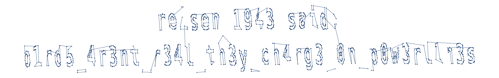

# CSCV2026 — Misc — Weirdo

**Thể loại:** Misc

**Kỹ thuật:** Network forensics · MAVLink · CRC validation · GPS visualization

**File:** `challenge.pcap`

**Flag:** `CSCV2026{b1rd5_4r3nt_r34l_th3y_ch4rg3_0n_p0w3rl1n3s}`

## 1. Khảo sát capture

File PCAP có dung lượng 52.251.302 byte, gồm 556.262 frame. Thống kê giao thức và hội thoại bằng Wireshark hoặc tshark:

```bash
tshark -r challenge.pcap -q -z io,phs -z conv,udp
```

Lưu lượng chủ yếu là UDP từ bốn địa chỉ `10.13.37.50`–`10.13.37.53` đến `10.13.37.10`, cùng cổng 14550. Payload bắt đầu bằng byte `0xfd`, phù hợp với MAVLink 2 — giao thức truyền dữ liệu thường gặp ở drone.

Bốn nguồn tương ứng với `sysid` từ 1 đến 4. Vì vậy cần phân tích riêng từng hệ thống, tránh trộn các đường bay.

## 2. Các chuỗi flag mồi

Tìm chuỗi ASCII trong file cho thấy nhiều bản tin `STATUSTEXT` (message ID 253) có nhãn `FLAG_PART`, cùng một bản tin:

```text
FLAG_MD5: 1e375de6074f25cd86ddab22948b5064
```

Một số bản tin bị lỗi một bit. Có thể kiểm tra checksum MAVLink, thử đảo từng bit trong payload và chỉ nhận sửa chữa khi có đúng một phương án khớp checksum được lưu. Với `STATUSTEXT`, CRC_EXTRA là 83.

Ghép các mảnh theo thứ tự frame và theo từng `sysid` thu được:

| sysid | Chuỗi ghép |
|---|---|
| 1 | `th3_sky_1s_n0t_r34l_5acb9c6b` |
| 2 | `trust_n0_s4t3ll1t3_3dc2bcc9` |
| 3 | `175_4_b1rd_175_4_pl4n3_175_5up3rm4n` |
| 4 | `r315en_kn0ws_t00_much_0b3e75ae` |

Chuỗi của sysid 1 khớp MD5 nhúng trong capture, nhưng khi bọc bằng `CSCV2026{...}` lại không được chấp nhận. Đây là nhánh gây nhiễu: checksum chỉ chứng minh dữ liệu được đọc hoặc khôi phục đúng, còn MD5 trong chính đề bài không chứng minh đó là flag thật.

## 3. Chuyển sang quỹ đạo GPS

Capture chứa nhiều dữ liệu vị trí. Khi vẽ riêng từng drone, quỹ đạo của `sysid=3` có hình dạng khác thường và gợi ra các nét chữ.

Thử với `GPS_RAW_INT` (ID 24) cho thấy dữ liệu nhiễu, các fix không hợp lệ và điểm ở độ cao bất thường. Một cách đọc rõ hơn là dùng `GLOBAL_POSITION_INT` (ID 33), vẫn của sysid 3.

Điều kiện trích xuất:

- `sysid == 3`.
- `message_id == 33`.
- Checksum MAVLink hợp lệ, dùng CRC_EXTRA = 104.

Sau khi lọc còn **3.302 bản tin hợp lệ**.

Trong payload `GLOBAL_POSITION_INT`, các trường đầu được bố trí như sau:

| Offset | Kiểu | Trường |
|---|---|---|
| 0 | uint32 | `time_boot_ms` |
| 4 | int32 | `lat` |
| 8 | int32 | `lon` |
| 12 | int32 | `alt` |

Các số dùng little-endian. Chia `lat` và `lon` cho `10^7` để đổi sang độ. MAVLink 2 có thể bỏ các byte 0 cuối payload; cần đệm lại trước khi unpack nếu thiếu chiều dài.

Tham khảo: [định nghĩa GLOBAL_POSITION_INT của MAVLink](https://github.com/mavlink/c_library_v2/blob/master/standard/mavlink_msg_global_position_int.h).

## 4. Dựng lại dòng chữ

Chỉ vẽ scatter khiến một số nét chữ trông đứt đoạn. Để đọc rõ hơn:

1. Giữ nguyên thứ tự điểm theo frame trong capture.
2. Đưa tọa độ về quanh gốc và nhân trục kinh độ với `cos(latitude)` để hiệu chỉnh tỷ lệ hai trục.
3. Dùng PCA/SVD để xoay hướng trải dài của quỹ đạo về nằm ngang.
4. Sửa hướng phản chiếu có thể xuất hiện do quy ước dấu của các trục PCA.
5. Nối các điểm liên tiếp gần nhau; bỏ các đoạn nhảy dài giữa các cụm chữ.

Script dùng ngưỡng khoảng cách `0.0003` trong hệ tọa độ đã hiệu chỉnh. Đây là lựa chọn để hiển thị nét chữ rõ hơn, không phải một trường hoặc điều kiện được MAVLink định nghĩa.

Kết quả có một dòng tiêu đề và dòng nội dung:

```text
b1rd5_4r3nt_r34l_th3y_ch4rg3_0n_p0w3rl1n3s
```



Các ký tự cần chú ý: `b1rd5` kết thúc bằng số **5**; `p0w3rl1n3s` có chữ **l** rồi số **1**; `0n` bắt đầu bằng số **0**.

## 5. Chạy lại kết quả

Script đầy đủ: [`solve.py`](solve.py). Script dựng hình để đọc bằng mắt, không sử dụng OCR và không hard-code flag vào hình.

**Môi trường đã kiểm tra:** Python 3.13, NumPy 2.3.5, Matplotlib 3.10.7.

Từ thư mục gốc repository:

```bash
python -m pip install -r CSCV2026/misc/weirdo/requirements.txt
python CSCV2026/misc/weirdo/solve.py /path/to/challenge.pcap --output gps-flag.png
```

Thay `/path/to/challenge.pcap` bằng đường dẫn đến file đề bài. Lấy file từ mục tải xuống của challenge **Weirdo**; file PCAP không được đóng gói trong repository này.

SHA-256 của file đã phân tích:

```text
b91551c7a916f978514ef2e4dd7539b9abee4515626bd1c141ebbde988f120f2
```

Đầu ra dự kiến: **3.302 điểm vị trí có CRC hợp lệ** và ảnh `gps-flag.png`. Parser được viết cho PCAP little-endian chứa Ethernet/IPv4/UDP của bài này, không phải công cụ đọc mọi định dạng capture.

## 6. Flag

Bọc dòng chữ đọc được bằng định dạng đề bài:

```text
CSCV2026{b1rd5_4r3nt_r34l_th3y_ch4rg3_0n_p0w3rl1n3s}
```

Flag này đã được người giải xác nhận đúng. Điểm quyết định của bài là nhận ra tọa độ drone đang vẽ chữ; các nhãn FLAG_PART và MD5 trong bản tin trạng thái là hướng gây nhiễu.

## 7. Bài học và ghi nhận

- Tách các nguồn telemetry trước khi dựng quỹ đạo; trộn sysid có thể che khuất tín hiệu.
- Kiểm tra checksum giúp loại dữ liệu lỗi, nhưng không xác nhận một manh mối là flag thật.
- Dữ liệu vị trí có thể mã hóa thông tin bằng hình học; thử trực quan hóa khi các chuỗi văn bản không dẫn đến kết quả.

Quá trình phân tích, viết script và biên soạn write-up có sử dụng hỗ trợ từ OpenAI Codex. Flag cuối cùng đã được người giải xác nhận đúng trên hệ thống chấm.
